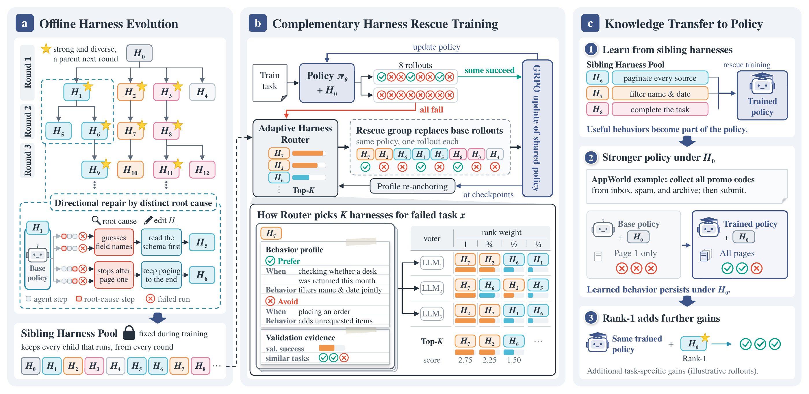
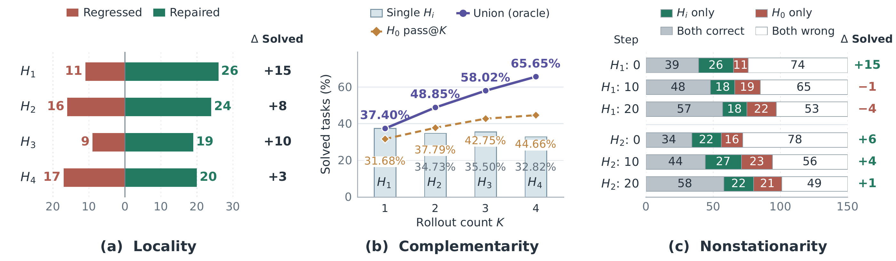

<h1 align="center">Harness-S</h1>
<h3 align="center">Learning from Sibling Harnesses for Generalizable Agent Training</h3>

<p align="center">
  <a href="https://github.com/DeepExperience/Harness-S"></a>
  <a href="https://www.python.org/downloads/"></a>
  <a href="LICENSE"></a>
  <a href="harness_pool/appworld"></a>
</p>

<p align="center">
  <a href="#overview">Overview</a> · <a href="#harness-evolution">Harness Evolution</a> ·
  <a href="#installation">Installation</a> ·
  <a href="#quick-start">Quick Start</a> · <a href="#harness-pool">Harness Pool</a> ·
  <a href="docs/reproduction.md">Reproduction</a> · <a href="docs/architecture.md">Architecture</a>
</p>

## Overview

**Harness-S** trains one agent policy using complementary trajectories from a fixed sibling harness pool. When every base-harness attempt fails, a validation-based rule selects auxiliary harnesses for fresh attempts. GRPO learns from the replacement group in each trajectory's own generating context. The trained policy can execute under the original harness or use task-specific routing at inference.

[](docs/figures/method_framework_text.pdf)

**Harness-S framework.** Directional evolution builds a reusable sibling pool; fresh sibling rollouts rescue all-failure tasks and train one shared policy; learned behaviors transfer back to the original harness H0, with optional Rank-1 routing at inference. Click the figure for the original PDF.

The figure shows the paper's full method, including behavior profiles and LLM voting. The public recipes default to validation-based rules with profile calibration disabled; the model-based path is [optional](docs/reproduction.md#optional-llm-routing-and-profiles).

This first release focuses on **AppWorld**: the frozen 20-member pool, exact task partitions, portable execution assets, rule-based rescue, optional behavior profiling and voting router, training scripts and evaluation scripts. Plain GRPO, H0 rescue and Harness-S share the same sampler, scorer, optimizer, validation and checkpoint lifecycle. Offline harness search has already produced the included pool; regenerating that search is outside this release's launch commands.

## Highlights

- **20 reusable harnesses:** H0 and 19 evolved siblings, with prompts, skills, context, memory, hooks and tool-view settings.
- **Selective rescue:** retain the base group when it contains a success; otherwise replace all eight trajectories with fresh auxiliary attempts.
- **Low-cost selection:** local task similarity and validation success rates select Top-8 siblings; profile calibration and LLM voting are off by default.
- **One training path:** established Dressage/Slime backend, policy-token masks, token importance correction, and **no reference-model KL**.
- **Portable recipes:** explicit environment variables, single seed, 32 concurrent tasks and one GPU per inference instance by default.
- **Limited checkpoints:** keep the validation-best and latest restart point during training; best and final after completion.

## Harness Evolution

Sibling harnesses start from a common H0 and share the same execution foundation. They vary the prompts, skills, context, memory, hooks, and tool views that support the policy. The paper identifies three properties of this evolution:

[](docs/figures/introduction.pdf)

**Properties of harness evolution (Qwen3.5-4B, AppWorld).** Left: repaired and regressed tasks relative to H0. Middle: individual success, sibling oracle union coverage, and H0 pass@K at matched rollout counts. Right: paired outcomes for fixed harnesses as the policy learns. Click the figure for the original PDF.

- **Locality:** a harness edit can repair some failures while introducing regressions on previously solved tasks. Different repair directions develop different strengths.
- **Complementarity:** siblings recover one another's errors. Their oracle union covers more tasks than individual variants or repeated H0 sampling at the same rollout count; this measures the pool's potential coverage, while a router must select harnesses before observing outcomes.
- **Nonstationarity:** a fixed harness's benefit changes with the policy. An advantage over H0 can turn into a disadvantage, and sibling rankings can reverse across checkpoints.

**Directional Harness Evolution** diagnoses failure causes and branches into targeted repairs. Joint validation coverage selects the next parents, while every executable, protocol-compliant child is retained in the pool. Rescue training uses that fixed pool to explore alternative behaviors on failed tasks and transfer them into the policy. This release includes the resulting AppWorld pool; rerunning the offline evolution search is outside its launch commands.

## Installation

The control commands require Python 3.10+. Training requires Linux, NVIDIA GPUs, Docker with GPU support, Node.js 22.19+ (or 24+), and a separately installed [AppWorld](https://github.com/StonyBrookNLP/appworld) environment and task data. The paper used eight H800 GPUs.

```bash
git clone https://github.com/DeepExperience/Harness-S.git
cd Harness-S
bash scripts/bootstrap.sh
bash scripts/build_image.sh
cp .env.example .env
# Edit .env with your own model, AppWorld and Node paths. Router API settings are optional.
source .env
```

`bootstrap.sh` retrieves the pinned Slime commit and applies the included compatibility patch. The adapted Dressage runtime and its Apache license are included under `third_party/`. The Docker image supplies the GPU training stack. Model weights, AppWorld databases and credentials are external inputs.

Convert your Hugging Face policy checkpoint using the pinned Slime converter before training. See [setup and conversion](docs/reproduction.md). Use the matching architecture recipe for 4B or 9B.

## Quick Start

Check the archive and prepare a run without allocating GPUs:

```bash
harness-s check-pool
harness-s prepare --config configs/appworld/harness_s_4b.json \
  --run-dir outputs/appworld-harness-s

bash scripts/train_appworld.sh --config configs/appworld/harness_s_4b.json \
  --run-dir outputs/appworld-harness-s --dry-run
```

Start or resume training:

```bash
bash scripts/train_appworld.sh --config configs/appworld/harness_s_4b.json \
  --run-dir outputs/appworld-harness-s
```

Choose `grpo_4b.json` for plain GRPO or `h0_rescue_4b.json` for fresh H0 resampling. Matching `*_9b.json` recipes are included. No default recipe requires a router API key. Each command uses the same training implementation.

Evaluate the best committed policy under H0, or rank one harness per task before its three attempts:

```bash
bash scripts/evaluate_appworld.sh --run-dir outputs/appworld-harness-s \
  --checkpoint best --harness h0
bash scripts/evaluate_appworld.sh --run-dir outputs/appworld-harness-s \
  --checkpoint best --harness rank1
```

Logs, selection evidence, optional profile/routing API returns, trajectories, metrics and restart records stay in the ignored run directory. The launcher starts an independent Ray head inside the training container and cleans up its own processes by PID. It does not stop or join the host Ray cluster.

Default selection retrieves the five nearest validation instructions using local TF-IDF cosine similarity, then ranks harnesses by their mean success on those same tasks. Ties use overall validation success, then harness ID. With no positive text similarity it uses overall validation success. Rescue excludes H0; rank-1 evaluation includes H0. Test outcomes never enter selection. Validation rollouts still run to update these statistics; the defaults remove profile-generation and voting API costs.

To enable the optional LLM/profile path, see [configuration](docs/reproduction.md#optional-llm-routing-and-profiles). This is a different selection strategy from the public rule-based default; historical experiment scores do not validate the new default.

## Harness Pool

The [AppWorld pool](harness_pool/appworld) contains the complete archive of **H0 + 19 auxiliaries**. Each member includes `harness.yml`, `state.json` and any `skills/`. The catalog records source identities and public-file checksums. Public YAML templates are rendered to absolute paths at preparation time.

The paper describes a 20-member routing pool. Some historical training runs used an H0-plus-nine subset; its exact [membership](harness_pool/appworld/subsets/historical_top10.json) is retained separately. The default public recipe uses all 20. It does not silently substitute the historical subset or claim new measurements for the expanded setup.

## Reproduction Notes

| Setting | AppWorld release |
| --- | --- |
| Task partitions | 320 train / 150 validation / 262 test |
| Training | 40 updates, task batch 8, group size 8, temperature 1 |
| Validation | Greedy, one rollout per task and harness; steps 0, 10, 20, 30, 40 |
| Profile calibration | Disabled by default (`profile_calibration.enabled=false`) |
| Selection | Rules by default (`router.mode="rules"`); no LLM calls or embedding model |
| Rescue | All-failure trigger; Top-8 distinct auxiliaries by nearby validation success |
| GRPO | Task-token mean, legacy token whitening, TIS clipped to [0, 2] |
| Ratio clipping | 0.20 lower / 0.28 upper |
| KL | 0; no reference probabilities |
| Test | Three attempts, temperature 1; Pass@3 and Avg@3 |
| Randomness | One run by default; split/rollout seed 42, optimizer seed 1234 |

Task IDs are disjoint; sibling variants can share task families across partitions. The paper's main-table averages over three independent runs are distinct from this repository's default single-run launch.

This extraction has CPU contract tests and release checks. **The portable GPU launcher has not yet completed an end-to-end training run.** Its defaults also change inference placement to one GPU per engine; historical runs often used two. Do not treat this release as a bitwise replay or a fresh confirmation of the reported scores. See [the implementation mapping and remaining validation](docs/reproduction.md).

## Repository Layout

```text
configs/appworld/        # 4B / 9B recipes for all three training variants
data/appworld/           # Frozen task IDs, order and family assignments
docs/figures/            # Paper figures: original PDFs and README PNG previews
harness_pool/appworld/   # Public H0 + 19 sibling implementations
src/harness_s/           # Shared orchestration, routing and AppWorld adapter
runtime/appworld/        # Fixed DSH composition, components and MCP replay
scripts/                # Setup, training, evaluation and release checks
third_party/            # Adapted Dressage, pinned Slime patch and notices
tests/                  # CPU method and artifact contract tests
```

## Development

```bash
python -m pip install -e '.[test]'
pytest -q
python scripts/check_release.py
```

## Acknowledgements

The execution and learning backend builds on [Dressage](https://github.com/Accio-Lab/Dressage), [Slime](https://github.com/THUDM/slime), [DeepSeek Harness](https://github.com/deepseek-ai/deepseek-harness), and [AppWorld](https://github.com/StonyBrookNLP/appworld), [SWE-Gym](https://github.com/SWE-Gym/SWE-Gym) and [DBBench (AgentBench)](https://github.com/THUDM/AgentBench). See [third-party notices](third_party/NOTICE.md) for versions and licensing.

## Citation

If you use Harness-S in your research, please cite our [paper](https://arxiv.org/abs/2611.04277):

```bibtex
@misc{zhang2026harnesss,
  title         = {{Harness-S}: Learning from Sibling Harnesses for Generalizable Agent Training},
  author        = {Kangning Zhang and Wenxiang Jiao and Bowen Fang and Shuai Shao and Jiachen Zhu and Rong Shan and Shijian Wang and Hao Wang and Yuan Lu and Weiwen Liu and Weinan Zhang},
  year          = {2026},
  eprint        = {2611.04277},
  archivePrefix = {arXiv},
  primaryClass  = {cs.AI},
  url           = {https://arxiv.org/abs/2611.04277}
}
```
