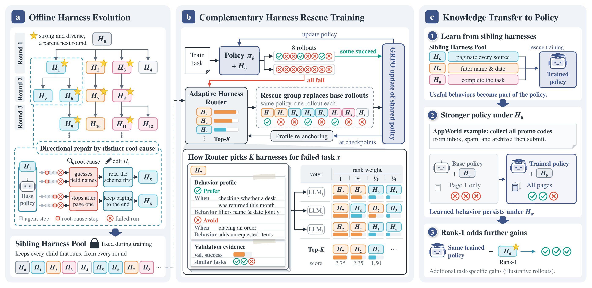
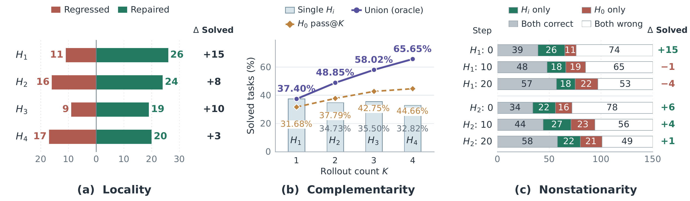

# Harness-S：AppWorld 开源代码

英文主页：[README.md](README.md)。

本仓库整理了论文对应的 AppWorld 训练流程、20 个固定 Harness、画像与 Router，以及训练和评估脚本。历史实验目录不需要放进公开仓库。

## 方法概览

[](docs/figures/method_framework_text.pdf)

定向演化先构建可复用的 Sibling Harness Pool；当 H0 下的全部尝试失败时，同一个策略在选出的辅助 Harness 下重新执行，用救援轨迹训练共享策略。训练目标是让学到的行为在原始 H0 下仍然有效，推理时也可使用 Rank-1 路由。点击图片可查看原始 PDF。

主图展示论文的完整方法，包含行为画像与 LLM 投票。开源默认配置使用 Validation 规则选择，并关闭 Profile calibration；画像和 LLM 投票可按[复现说明](docs/reproduction.md#optional-llm-routing-and-profiles)显式开启。

## Harness Evolution 的三个特性

[](docs/figures/introduction.pdf)

上图来自论文中 Qwen3.5-4B 在 AppWorld 上的分析。左图比较相对 H0 修复和退化的任务；中图比较单个 Harness、多个 sibling 的 oracle 联合覆盖率，以及相同 rollout 数量下的 H0 pass@K；右图展示固定 Harness 在不同策略 checkpoint 下的配对结果。点击图片可查看原始 PDF。

- **局部性（Locality）**：一次 Harness 修改可能修复部分失败，也可能让原本成功的任务退化，因此不同修复方向形成不同专长。
- **互补性（Complementarity）**：不同 sibling 能弥补彼此的错误，其 oracle 联合覆盖率高于单个变体或等次数的 H0 重采样。Oracle 表示池的潜在覆盖能力，实际 Router 仍需在执行前选择 Harness。
- **非平稳性（Nonstationarity）**：同一个 Harness 的效用随策略学习而变化，相对 H0 的优势可能转为劣势，变体排名也可能反转。

Directional Harness Evolution 根据失败根因分支生成定向修复，以联合 Validation 覆盖率选择下一轮父代，并保留所有可执行、符合协议的子代。得到的池在策略训练期间保持固定，救援训练从这些互补执行方式中学习，再将能力迁移到共享策略。本仓库提供已经生成的 AppWorld 池；启动脚本不包含离线演化搜索。

## 快速开始

先运行 `bash scripts/bootstrap.sh` 和 `bash scripts/build_image.sh`，再复制 `.env.example` 为 `.env`，填写模型、已转换的 Megatron checkpoint、AppWorld、Node 路径（默认无需 Router API），执行 `source .env`。

```bash
# 仅检查启动命令，不使用 GPU
bash scripts/train_appworld.sh --config configs/appworld/harness_s_4b.json \
  --run-dir outputs/appworld-harness-s --dry-run

# 启动；中断后同一命令从最近已提交的 checkpoint 恢复
bash scripts/train_appworld.sh --config configs/appworld/harness_s_4b.json \
  --run-dir outputs/appworld-harness-s

# 在 H0 下评估最佳模型
bash scripts/evaluate_appworld.sh --run-dir outputs/appworld-harness-s \
  --checkpoint best --harness h0
```

基线分别使用 `grpo_4b.json` 与 `h0_rescue_4b.json`；9B 有对应配置。三个方法共用训练代码。默认单次运行、32 并发、KL=0、单卡推理实例；训练保留最佳点和最新恢复点，结束保留最佳点和最终点。

默认配置为 `profile_calibration.enabled=false`、`router.mode="rules"`。规则选择通过本地 TF-IDF 余弦相似度取最近 5 个 Validation 任务，按各 Harness 在这些相同任务上的平均成功率排序；并列时选整个 Validation 集成功率更高者，再以 Harness ID 确定顺序。H0 的 8 次尝试全失败时，选择 Top-8 个不同辅助 Harness 各救援一次；无正相似度时按全局 Validation 成功率回退。无需额外 embedding 模型、画像 API 或投票 API。仍在第 0、10、20、30、40 步评测 Validation，以更新成功率；`rank1` 评估也使用同一规则，候选中包含 H0。

可选画像与 LLM 投票的启用方法见 [复现说明](docs/reproduction.md#optional-llm-routing-and-profiles)。原投票实现默认是同一模型独立调用 6 次，配置多个 `backends` 后才轮换不同模型。API Key 通过环境变量传入，示例留空，`.env` 和运行输出被 Git 忽略，请勿把密钥写进配置。

完整 Pool 为 H0 加 19 个变体；历史部分实验实际使用的 10 成员子集单独记录。公开默认使用完整池，不能把历史子集成绩直接当成这个新配置的实测成绩。默认关闭 Profile calibration 和 LLM Router，不修改固定 Harness。离线搜索重新生成 Pool 不在这次启动脚本范围内。

已提供 CPU 测试和发布检查；新整理的便携 GPU 启动流程尚未完成一次端到端训练验证。复现条件和差异详见 [docs/reproduction.md](docs/reproduction.md)。
